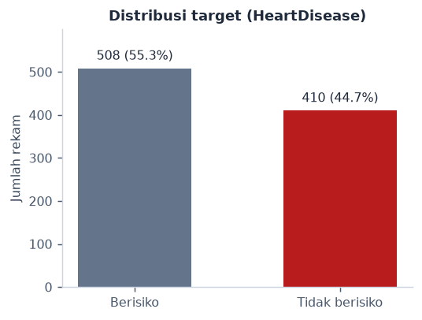
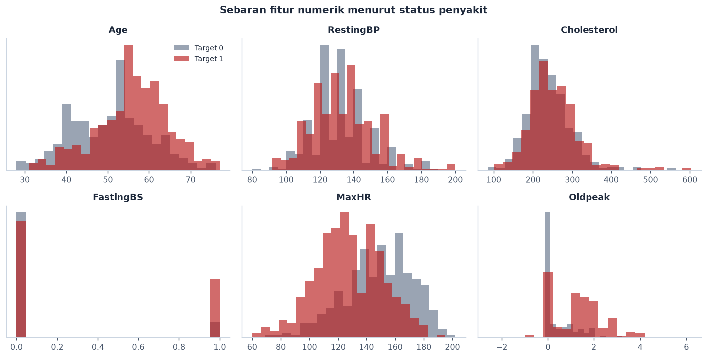
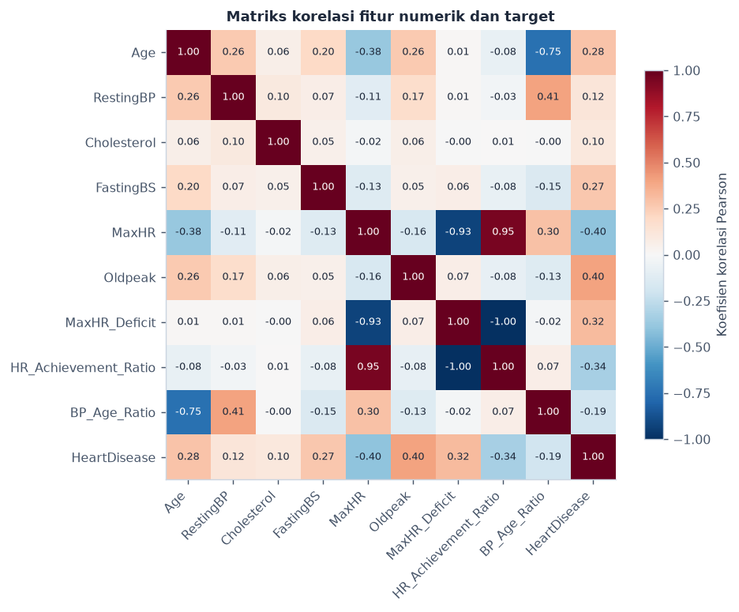
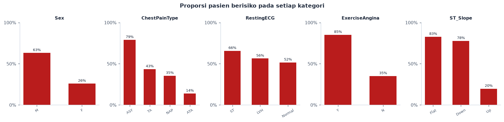
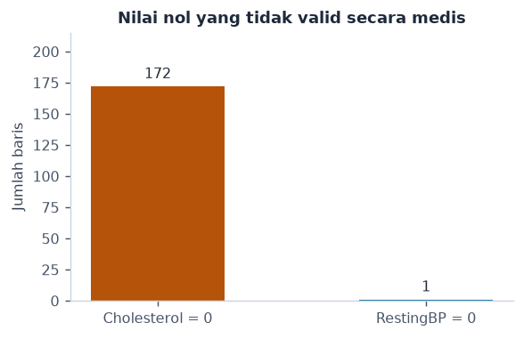

# Ringkasan EDA — Heart Failure Prediction

- Jumlah rekam: **918**, fitur: **11**
- Prevalensi penyakit jantung: **55.3%** (508 positif / 918 rekam)
- Nilai tidak hilang secara eksplisit: **0** sel

## Anomali nilai nol

- `Cholesterol = 0` pada **172** baris (18.7%). Nilai ini tidak mungkin secara fisiologis dan diperlakukan sebagai data hilang.
- `RestingBP = 0` pada **1** baris.
- Karena proporsi kolesterol yang hilang cukup besar, imputasi median dilakukan di dalam pipeline (hanya memakai statistik data latih) dan hasil model perlu dibaca dengan hati-hati.

## Korelasi terhadap target

| Fitur | Korelasi dengan HeartDisease |
| --- | ---: |
| Oldpeak | +0.404 |
| MaxHR | -0.400 |
| Age | +0.282 |
| FastingBS | +0.267 |

## Temuan utama

- `ST_Slope` dan `ExerciseAngina` menunjukkan pemisahan kelas yang jelas: pasien dengan ST menurun/mendatar dan angina saat olahraga jauh lebih sering berstatus positif.
- `MaxHR` cenderung lebih rendah pada pasien berisiko, sehingga fitur turunan cadangan detak jantung (`MaxHR_Deficit`, `HR_Achievement_Ratio`) relevan secara klinis.
- `ChestPainType = ASY` (asimtomatik) justru berkaitan dengan proporsi penyakit yang tinggi, menegaskan bahwa tidak adanya gejala bukan berarti risiko rendah.

## Gambar

